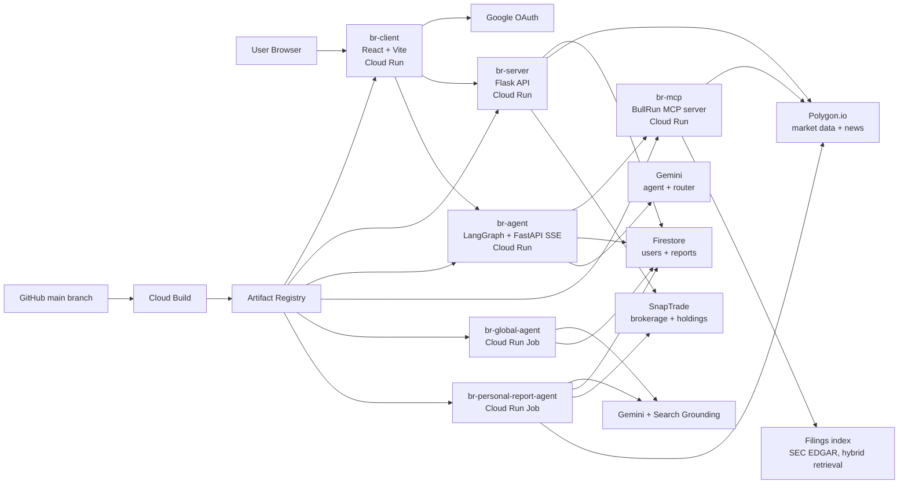

# BullrunAI

BullrunAI is an AI-powered investing dashboard that turns a user's watchlist
and connected brokerage portfolio into personalized market briefings.

It combines portfolio data, live market data, market news, and LLM-generated
analysis to help users quickly understand what is moving, why it matters, and
what to watch next.

The product is deployed on a production-style GCP architecture using Cloud Run,
Cloud Run Jobs, Firestore, Artifact Registry, and Cloud Build CI/CD.

> BullrunAI is for market education and research. It is not financial advice.

Built by Rishabh Patil and Pramit Bhatia (Best Generative AI Hack, Hacklytics 2025).

## What's new in 2.0: the agent layer

The original chatbot was a keyword filter in front of a single Gemini call. 2.0 adds
[`agent_service/`](agent_service/README.md):

- **Spade, a LangGraph research agent**: LLM guardrail router, tool-calling loop over
  quotes, news, SEC filings and the user's portfolio, per-thread memory, and
  **human-in-the-loop approval** before it edits a watchlist.
- **Filings RAG**: 10-K/10-Q from SEC EDGAR, section-aware chunking, hybrid BM25 + dense
  retrieval with Reciprocal Rank Fusion, answers cited as `[S1]` with links to the filing.
- **BullRun MCP server**: the research tools as an MCP server (tools, resources, prompts),
  consumed by the agent over HTTP and usable from Claude Desktop or Cursor over stdio.
- **Evals in CI**: golden dataset for routing, tool selection, citations, disclaimers and
  HITL, plus LLM-as-judge groundedness and retrieval hit@k/MRR, gating GitHub Actions.
- **Streaming UI**: the chat panel shows live tool steps, approval cards, sources, latency and tokens.
- **LLMOps**: provider-agnostic models (Gemini/OpenAI/Anthropic), LangSmith tracing,
  Secret Manager, per-user rate limits, Docker Compose for local and Cloud Build for deploy.

## High-Level System Design



## What It Does

BullrunAI gives users a personalized market workspace with:

- Google OAuth login and onboarding
- Watchlist creation and editing
- Market dashboard with key movements, implications, and watch points
- Live ticker and market data from Polygon
- Brokerage account linking through SnapTrade
- Portfolio summaries across connected accounts
- AI-generated global market reports
- AI-generated personalized reports based on watchlist and portfolio context
- Spade research agent: tool-using LangGraph agent with cited SEC filings, memory and approval-gated actions
- BullRun MCP server for using the research tools from any MCP client

## Product Architecture

BullrunAI is split into five deployable components:

| Component | Runtime | Purpose |
| --- | --- | --- |
| `client/` | React + Vite | User-facing dashboard and portfolio UI |
| `server/` | Flask + Gunicorn | API layer for auth, users, market data, portfolio, reports, and chatbot |
| `global_report_agent/` | Python Cloud Run Job | Generates global market reports using Gemini and market context |
| `personal_report_agent/` | Python Cloud Run Job | Generates personalized user reports from portfolio/watchlist context |
| `agent_service/` | FastAPI + LangGraph, FastMCP (Cloud Run) | Spade research agent API (SSE) and the BullRun MCP server |

## Infrastructure Overview

BullrunAI runs on **BR-Prod**, a GCP-based production environment.

Core infrastructure:

- **Cloud Run Services**
  - `br-client`: serves the React frontend
  - `br-server`: serves the Flask API

- **Cloud Run Jobs**
  - `br-global-agent`: generates global market reports
  - `br-personal-report-agent`: generates personalized reports for onboarded users

- **Firestore**
  - Stores users, onboarding data, watchlists, generated reports, and SnapTrade user mappings

- **Artifact Registry**
  - Stores Docker images for each deployable component

- **Cloud Build**
  - Builds and deploys services from GitHub pushes to `main`

- **External Integrations**
  - Google OAuth for authentication
  - SnapTrade for brokerage linking
  - Polygon.io for market data and news
  - Gemini for report generation and chatbot responses

## Tech Stack

### Frontend

- React
- Vite
- React Router
- TanStack Query
- Recharts
- TradingView widgets
- Google OAuth

### Backend

- Python
- Flask
- Gunicorn
- Firestore
- Google Auth
- SnapTrade SDK
- Polygon.io API
- Gemini API

### Infrastructure

- Google Cloud Run
- Google Cloud Run Jobs
- Google Cloud Build
- Google Artifact Registry
- Google Firestore
- Docker

## Local Development

### Frontend

```bash
cd client
npm install
npm run dev
```

### Backend

```bash
cd server
python -m venv .venv
source .venv/bin/activate
pip install -r requirements.txt
flask --app app run --port 8080
```

### Global Report Agent

```bash
cd global_report_agent
python -m venv .venv
source .venv/bin/activate
pip install -r requirements.txt
python main.py --dry-run
```

### Personal Report Agent

```bash
cd personal_report_agent
python -m venv .venv
source .venv/bin/activate
pip install -r requirements.txt
python main.py --dry-run --limit-users 1
```

## Deployment

Each component has its own Dockerfile and Cloud Build config.

On push to `main`, Cloud Build can:

1. Build the Docker image.
2. Push it to Artifact Registry.
3. Deploy the service to Cloud Run, or update the image used by a Cloud Run Job.

Example components:

```text
client/cloudbuild.yaml
server/cloudbuild.yaml
global_report_agent/cloudbuild.yaml
personal_report_agent/cloudbuild.yaml
```

This keeps frontend, API, and background agents independently deployable.

## Why This Architecture

BullrunAI uses Cloud Run and Cloud Run Jobs because the product has two different
workload types:

1. **User-facing request/response services**
   - Login
   - Dashboard
   - Portfolio
   - Market data
   - Chatbot

2. **Background AI jobs**
   - Global report generation
   - Personalized report generation

Keeping these workloads separate makes the system easier to operate. The API
remains responsive while report generation runs independently in jobs.

Firestore is used because the product's early data model is document-oriented:
users, onboarding state, watchlists, generated reports, and user-specific report
history.

Cloud Build and Artifact Registry provide a real CI/CD path, while Cloud Run
keeps hosting simple, scalable, and cost-efficient.

## Roadmap

Planned improvements:

- Redesign the dashboard UI for a more polished investor experience
- Add public landing page and demo account
- Add email delivery for daily personalized reports
- Move the Flask server and report jobs to Secret Manager (the agent service already uses it)
- Add Cloud Scheduler definitions for report jobs
- Add API tests for auth, watchlist, reports, and SnapTrade flows
- Add observability for API latency, job failures, report freshness, and LLM cost
- Add queue-based fanout for personalized report generation at larger scale
- Add subscription and billing support
- Port the global/personal report jobs onto the LangGraph agent with eval coverage
- Add a cross-encoder reranker and semantic response cache to the RAG path
