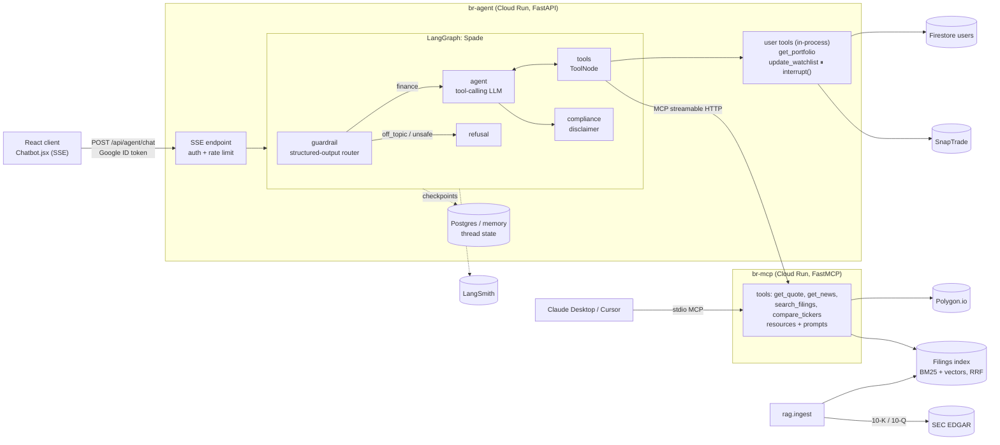

# BullRun Agent Service (BullRun 2.0)

The GenAI layer of BullRun: **Spade**, a LangGraph research agent that answers investing
questions with live market data, cited SEC filings and the user's own portfolio, plus a
**BullRun MCP server** that exposes the same research tools to any MCP client.

It replaces the original single-prompt `/api/chatbot/query` endpoint (keyword filter → one
Gemini call, no tools, no memory) with a tool-using agent, retrieval, human approval for
writes, streaming, evals and tracing.

## Architecture



### What each piece demonstrates

| Area | Implementation | Where |
|---|---|---|
| **Agent orchestration** | LangGraph `StateGraph`: guardrail → agent ⇄ tools → compliance; loop guard on tool steps | `bullrun_agent/graph/builder.py` |
| **Tool calling** | 5 typed LangChain tools; parallel calls; tool errors returned to the model, not thrown | `bullrun_agent/tools.py` |
| **Human-in-the-loop** | `update_watchlist` calls `interrupt()`; UI shows Approve/Decline; `/resume` sends `Command(resume=...)` | `tools.py`, `api.py`, `Chatbot.jsx` |
| **Memory** | Per-thread checkpointer (InMemorySaver → `AsyncPostgresSaver` via `CHECKPOINT_DB_URL`); history window trimmed with `trim_messages` | `graph/builder.py` |
| **Guardrails** | LLM router with Pydantic structured output (finance / off_topic / unsafe + advice flag) replaces the 90-keyword regex; deterministic disclaimer node | `graph/` |
| **RAG** | EDGAR ingest → section-aware chunking (Item 1A, Item 7…) → hybrid BM25 + dense retrieval fused with Reciprocal Rank Fusion → `[S#]` citations with filing URLs | `bullrun_agent/rag/` |
| **MCP** | FastMCP server with tools, resources and prompts; agent consumes it via `langchain-mcp-adapters`; same server works over stdio for Claude Desktop | `bullrun_agent/mcp_server.py` |
| **Streaming** | SSE events: `route`, `token`, `tool_start`, `tool_end`, `approval_required`, `final` (with citations, tokens, latency) | `api.py`, `client/src/lib/agentStream.js` |
| **Evals** | 20-case golden set (routing, tool selection, parallelism, disclaimer, HITL, citations) + LLM-as-judge groundedness; retrieval hit@k / MRR; CI quality gates | `evals/` |
| **LLMOps** | Provider-agnostic factory (Gemini / OpenAI / Anthropic / offline fake), LangSmith tracing, per-request token + latency, per-user rate limit | `llm.py`, `api.py` |
| **Security** | Google ID-token auth; threads namespaced by user; identity injected via `RunnableConfig` (the model can't pick whose portfolio to read); markdown rendered without raw HTML | `api.py`, `tools.py` |

## Quickstart (local)

```bash
cd agent_service
python -m venv .venv && .venv\Scripts\activate        # Windows  (mac/linux: source .venv/bin/activate)
pip install -r requirements-dev.txt
copy .env.example .env                                  # then set GOOGLE_API_KEY (mac/linux: cp)

python -m pytest -q                                     # 14 offline tests, no keys needed
python -m bullrun_agent.rag.ingest --tickers NVDA AAPL MSFT TSLA   # build filings index (~2-5 min)
uvicorn bullrun_agent.api:app --reload --port 8080      # agent API
python -m bullrun_agent.cli                             # chat with Spade in the terminal
```

Then in `client/.env` add `VITE_AGENT_API_URL=http://localhost:8080` and run `npm run dev`.

No API keys at all? `LLM_PROVIDER=fake EMBEDDING_PROVIDER=hash` runs everything with a
scripted model and demo data, which is useful for UI work.

### Try the MCP server in Claude Desktop

Add to `claude_desktop_config.json` (Settings → Developer → Edit Config):

```json
{
  "mcpServers": {
    "bullrun": {
      "command": "C:\\path\\to\\bullrunAI\\agent_service\\.venv\\Scripts\\python.exe",
      "args": ["-m", "bullrun_agent.mcp_server"],
      "cwd": "C:\\path\\to\\bullrunAI\\agent_service",
      "env": { "GOOGLE_API_KEY": "...", "POLYGON_API_KEY": "..." }
    }
  }
}
```

Ask Claude *"Use the analyze_ticker prompt for NVDA"* and it will call BullRun's tools.

### MCP mode for the agent

```bash
python -m bullrun_agent.mcp_server --http --port 8765   # terminal 1
set TOOLS_MODE=mcp && uvicorn bullrun_agent.api:app --port 8080   # terminal 2
```

Or run the whole stack (MCP + agent + Postgres memory): `docker compose up --build` from the repo root.

## Evals

```bash
python -m evals.run_evals                  # agent + retrieval, with LLM judge
python -m evals.run_evals --only rag       # just the RAG-tagged cases
python -m evals.run_evals --suite retrieval --k 5
```

Reports land in `evals/results/` (JSON + Markdown). Gates (route accuracy ≥ 0.90,
tool recall ≥ 0.80, disclaimer 100%, HITL 100%, citations ≥ 0.80, groundedness ≥ 4/5,
retrieval hit@5 ≥ 0.70) fail the GitHub Action when missed.

## API

| Method | Path | Body | Returns |
|---|---|---|---|
| POST | `/api/agent/chat` | `{message, thread_id?}` | SSE stream |
| POST | `/api/agent/resume` | `{thread_id, approved}` | SSE stream |
| GET | `/api/agent/threads/{id}` | | `{messages, pending_approval}` |
| GET | `/health` | | provider, model, demo flags, index stats |

Deployment: see [`DEPLOY.md`](DEPLOY.md).
